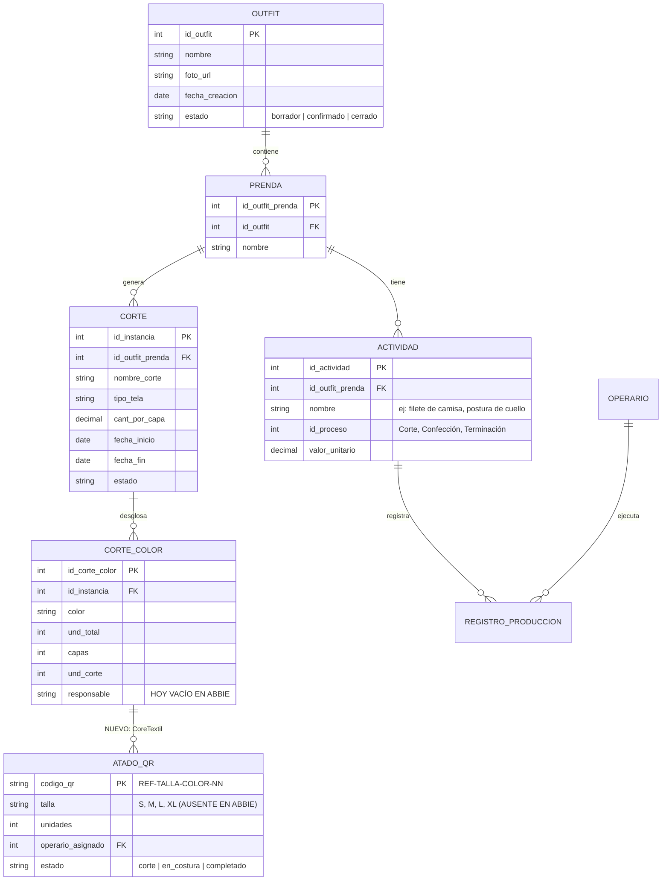

# 👗 REINGENIERÍA, MAPEO Y PLAN DE CLONACIÓN: ABBIE × CORETEXTIL

> **Auditoría Forense y Mapeo Funcional del Sistema de Producción de Abbie**  
> **Objetivo:** Clonar con precisión milimétrica la identidad visual de Abbie (`abbie.site`), replicar sus módulos funcionales nativos e inyectar el motor inteligente de **CoreTextil** (QR, Visor 2D, Trazabilidad por Atados/Talla/Color y Vision Engine con IA).

---

## 🎨 1. ESPECIFICACIÓN DEL SISTEMA DE DISEÑO (LOOK & FEEL NATIVO DE ABBIE)

| Token Visual | Valor CSS / Hex | Uso en el Sistema |
| :--- | :--- | :--- |
| **Fondo Principal** | `linear-gradient(135deg, #f78bc9 0%, #f9c2d9 100%)` | Fondo dinámico en toda la aplicación y login |
| **Color Primario (Abbie Red)** | `#c0192e` | Botones principales, cabeceras, títulos y detalles destacados |
| **Color Acento (Abbie Pink)** | `#f78bc9` | Bordes destacados de tarjetas, fondos suaves y focus |
| **Color Texto** | `#231f20` | Tipografía principal de lectura |
| **Tarjetas (Card Ghost)** | `background: #ffffff; border-radius: 12px; border-left: 5px solid #f78bc9; box-shadow: 0 10px 30px rgba(0,0,0,.1);` | Contenedores principales de información con elevación |
| **Tipografía** | `'Poppins', sans-serif` (Google Fonts 400, 500, 700) | Estilo moderno, estilizado y limpio para moda textil |
| **Iconografía** | FontAwesome 6 (`fas fa-tshirt`, `fas fa-cut`, `fas fa-cogs`, `fas fa-qrcode`) | Iconos de navegación y acciones |
| **Logo Oficial** | Logo curvado cursivo "Abbie" en blanco/rosa | Navbar y encabezados |

---

## 🏗️ 2. MAPEO DE ESTRUCTURA Y BASE DE DATOS INFERIDA

A partir de la inspección de endpoints (`api_pendientes.php`, `outfits/show.php`, `corte/show.php`, `produccion/registro_operario.php`):



---

## 🔍 3. LOS 5 PUNTOS CIEGOS CRÍTICOS DEL SISTEMA DE ABBIE

1. **Ausencia de Tallas en Producción:**
   El módulo `registro_operario.php` solo discrimina por `id_color`. ¡No existe campo ni registro de Tallas (S, M, L, XL)! El dueño no sabe si están confeccionando las tallas grandes o las pequeñas.
2. **Selección Manual Caótica (Dropdown de 300 opciones):**
   Para registrar una labor, el operario debe buscar su prenda en un `<select>` con más de 300 conjuntos históricos desde junio hasta noviembre. Es lento, confuso e induce a errores continuos de digitación.
3. **Cero Trazabilidad de Atados (Campo 'Responsable' Vacío):**
   En `corte_show.php`, la columna **Responsable** aparece como `—` (vacía). Los cortes no se dividen en atados físicos; se manejan como bultos globales sin dueño asignado.
4. **Sin Visor 2D / Estado en Vivo de la Prenda:**
   Solo existe una foto JPG fija del conjunto terminado. Nadie puede ver si la prenda tiene listos los cuellos, el delantero, los puños o la bota.
5. **Riesgo de Fraude de Destajo:**
   No hay validación en tiempo real por atado. El operario ingresa cantidades en un campo numérico abierto.

---

## 🚀 4. EL PLAN DE CLONACIÓN & EVOLUCIÓN (CORETEXTIL SUPERPOWERS)

Vamos a crear la aplicación clon con Vite + React + TypeScript + Bootstrap/Poppins, manteniendo el 100% de la estética familiar para ellos, pero integrando 4 botones revolucionarios:

### 🌟 Módulo 1: "Escáner QR de Atados" (Reemplaza el Dropdown)
* El operario no busca en listas infinitas: activa la cámara de su teléfono o pistola USB, escanea la etiqueta del atado (`NATALIA-M-MARFIL-03`) y la pantalla se autocompleta al instante con el color, la talla, la prenda y las piezas pendientes.

### 🌟 Módulo 2: "Matriz Talla × Color × Cuadrilla"
* Llena automáticamente el campo "Responsable" de Abbie. Una cuadrícula donde el jefe asigna:
  * *Talla M / Café Moka* ➔ Operario: Daniel (Fileteadora).
  * *Talla S / Marfil* ➔ Operario: Rosa (Plana).

### 🌟 Módulo 3: "Visor 2D de Estado en Tiempo Real"
* Un modelo SVG interactivo del conjunto que se ilumina por partes:
  * 🟢 Verde: Operación terminada.
  * 🟡 Amarillo: En máquina actual.
  * ⚪ Gris: Pendiente.

### 🌟 Módulo 4: "Vision Engine con IA"
* En la creación de Conjuntos, botón: **"Analizar con IA (CoreTextil)"**.
* Sube la foto del conjunto y Gemini extrae en 3 segundos la lista de actividades que hoy escriben una por una a mano.

---

## 📁 Estructura del Proyecto Clonado (`C:\Users\Usuario\Documents\abbie_coretextil`)

```
abbie_coretextil/
├── assets/
│   ├── logo.png (Logo original de Abbie)
│   └── 1786019632_3a65bd7a377edc65.jpg (Foto de referencia)
├── html/ (Dump completo de las pantallas de producción)
│   ├── index.php
│   ├── outfits_index.php
│   ├── outfits_show.php
│   ├── corte_index.php
│   ├── corte_show.php
│   ├── produccion_registro_operario.php
│   └── produccion_historial_operarios.php
├── ESTRUCTURA_Y_PLAN_CLONACION.md (Este documento maestro)
└── src/ (Aplicación React / CoreTextil lista para desplegar)
```
