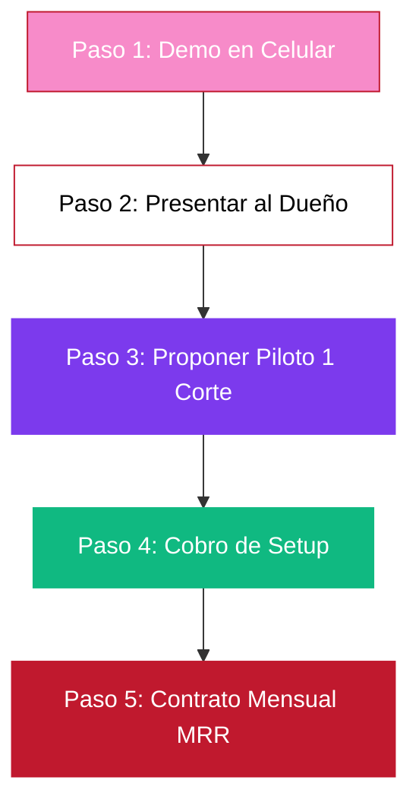

# 👗 HOJA DE RUTA ESTRATÉGICA & PROPUESTA DE NEGOCIO: ABBI × CORETEXTIL

> **Documento Confidencial de Estrategia Técnica y Comercial**  
> **Autor:** Beatriz — Serie X Elite (Co-CEO Tecnológica) para Wily Col  
> **Ubicación del Proyecto:** `C:\Users\Usuario\Documents\ABBI`  
> **Objetivo:** Hoja de ruta para capturar la cuenta de **ABBI**, monetizar la implementación y asegurar un contrato de **ingresos recurrentes mensuales (MRR)** por mantenimiento y soporte.

---

## 🎯 RESUMEN EJECUTIVO
La empresa **ABBI** cuenta actualmente con un software web básico (`abbie.site`), pero sufre de **ceguera operativa severa** en planta de confección:
* No tienen trazabilidad física de lotes (los cortes viajan sin identificación).
* No discriminan tallas en producción (solo ven color).
* Los operarios registran cantidades a mano desde un selector caótico de 300 prendas.
* El campo "Responsable" de corte está 100% vacío.
* No existe ningún control visual ni validación estricta de piezas cortadas vs. pagadas.

Nuestra tecnología **CoreTextil** resuelve cada una de estas fallas con un software moderno, visual y móvil que se integra de inmediato. Hay una **oportunidad de negocio inmediata de $3.500.000 a $6.000.000 COP por implementación inicial**, más **$450.000 a $750.000 COP mensuales recurrentes** por soporte y mantenimiento.

---

## 🔍 1. DIAGNÓSTICO FORENSE DEL SISTEMA ACTUAL DE ABBI

### Arquitectura Técnica Encontrada:
* **Backend:** PHP 8.3 / LiteSpeed Server alojado en Hostinger.
* **Frontend:** Bootstrap 5.3.3 / jQuery / CSS personalizado con gradiente rosa (`#f78bc9` a `#f9c2d9`).
* **Base de Datos:** MySQL relacional (inferida por endpoints `api_pendientes.php` y tablas `outfit_prenda`, `instancia`, `actividades`).

### Las 5 Fugas Financieras que Sufre el Dueño:

| Falla en ABBI | Consecuencia en Planta | Dinero que Pierden |
| :--- | :--- | :--- |
| **1. Sin Trazabilidad de Atados (Sin QR)** | Bultos de 25-50 piezas se pierden entre mesas de corte, fileteadoras y satélites. Nadie sabe la ubicación física del lote. | Prendas refundidas, pedidos incompletos y entregas tardías a clientes. |
| **2. Cero Tallas en Producción** | El formulario de registro solo pregunta `id_color` y cantidad. No guardan la talla (S, M, L, XL). | No saben si las prendas cortadas corresponden a lo que realmente se ensambló. |
| **3. Dropdown Manual de 300 Outfits** | El operario pierde minutos buscando su prenda entre nombres como "Lupe 14 nov", "Olivia bengalina", etc. | Tiempo muerto acumulado en cuadrilla; registros asignados a la prenda equivocada. |
| **4. Fraude de Destajo (Sobrerreporte)** | Al no haber topes automáticos por atado en base de datos, los operarios pueden registrar más piezas de las cortadas. | Pagos de nómina inflados por piezas fantasma que nunca se cortaron. |
| **5. Sin Visor 2D ni Estado en Vivo** | Solo tienen una foto JPG fija. El dueño tiene que caminar por toda la fábrica o llamar para saber en qué va la producción. | Pérdida de control gerencial y dependencia absoluta de reportes verbales. |

---

## 💎 2. EL ARSENAL DE SOLUCIONES DE CORETEXTIL (YA CLONADO EN `C:\Users\Usuario\Documents\ABBI`)

En la carpeta del proyecto ya dejamos implementada la solución funcional con la misma estética de ABBI:

### 🔲 Solución 1: Escáner QR de Atados (`REF-TALLA-COLOR-NN`)
* Cada atado físico que sale de corte lleva una etiqueta con código QR.
* El operario no busca en listas: abre la cámara de su teléfono o pasa el lector USB, **escanea el QR y la pantalla se llena en 0.2 segundos** con la prenda, la talla, el color y las piezas del lote.

### 🎨 Solución 2: Matriz Talla × Color × Cuadrilla
* Resuelve el campo "Responsable" que hoy aparece vacío en ABBI.
* El jefe de producción ve una cuadrícula interactiva y asigna con un clic:
  * *Talla S / Café Moka* ➔ Operario: WILLY 19N.
  * *Talla M / Marfil* ➔ Operaria: Carmen Silva.

### 👕 Solución 3: Visor 2D Dinámico de Prenda
* Un modelo digital en pantalla que se "ilumina" por partes:
  * 🟢 **Verde:** Operación completada (cuello camisero listo, cartera cerrada).
  * 🟡 **Amarillo:** Operación en máquina en este momento.
  * ⚪ **Gris:** Operación pendiente.
* El dueño puede ver desde su oficina o su celular cómo se va armando físicamente cada conjunto.

### 🧬 Solución 4: Auto-Despiece con IA (Vision Engine V2)
* En vez de escribir 40 actividades a mano por conjunto, el diseñador sube la foto de la prenda y Gemini extrae en 3 segundos los moldes, las operaciones requeridas, los tiempos SAM y los costos sugeridos.

### 🛡️ Solución 5: Blindaje Anti-Fraude de Nómina
* Validación estricta a nivel de base de datos (`FOR UPDATE`). Si el lote tiene 25 piezas, el sistema rechaza matemáticamente cualquier intento de registrar 26 piezas.

---

## 💰 3. MODELO DE NEGOCIO: CÓMO MONETIZAR ESTA OPORTUNIDAD

Para asegurar la venta y convertir a ABBI en un cliente rentable a largo plazo, utilizaremos un **modelo de doble vía**:

```
[INGRESOS INICIALES]              [INGRESOS RECURRENTES (MRR)]
  Implementación & Setup            Mantenimiento & Soporte Mensual
  $3.500.000 - $5.500.000 COP       $450.000 - $650.000 COP / mes
```

### Propuesta Económica Detallada para el Dueño:

#### Opción A: "Paquete Piloto Rápido" (Cero Riesgo)
* **Alcance:** Implementación del módulo de Atados QR y Visor 2D para 1 línea de producción activa.
* **Precio de Setup:** **$2.500.000 COP** (pago único 50% inicio, 50% entrega).
* **Mantenimiento Mensual:** **$350.000 COP / mes** (incluye servidor cloud, base de datos y soporte técnico).

#### Opción B: "Transformación Integral Planta Inteligente" (Recomendada)
* **Alcance:**
  1. Integración completa de QRs con su sistema actual o migración a CoreTextil.
  2. Matriz de asignación Talla × Color para todos los cortes.
  3. Visor 2D interactivo en tiempo real.
  4. Generador de tiquetes QR para impresora térmica de corte.
  5. Capacitación a cortadores y operarios.
* **Precio de Setup:** **$4.800.000 COP** (en 3 cuotas: anticipo, avance y entrega).
* **Mantenimiento & Soporte Continuo:** **$550.000 COP / mes** (mantenimiento preventivo, backups diarios, actualización de software y soporte para nuevas referencias).

---

## 📈 4. EL ARGUMENTO FINANCIERO (ROI PARA EL DUEÑO)

Cuando hables con el dueño de ABBI, no le vendas "software", **véndele dinero recuperado**:

> *"Don [Nombre], una fábrica con el volumen de ABBI corta miles de prendas al mes. En la industria textil tradicional se calcula que entre **piezas que se pagan de más por destajo descontrolado** y **atados que se refundan o atrasan**, se pierde entre el **4% y el 7% de la utilidad bruta** de cada corte.
> 
> En un mes de 5.000 prendas, eso son más de **$2.500.000 a $4.000.000 de pesos que se evaporan**.
> 
> Con CoreTextil, nuestro sistema se paga solo desde el primer mes, porque usted no volverá a pagar una sola prenda que no se haya cortado ni se le volverá a perder un solo atado."*

---

## 🧭 5. RUTA DE ACCIÓN INMEDIATA PARA WILY



1. **Paso 1 (Hoy):** Levantamos el clon en vivo o en Vercel para que Wily lo tenga en su celular.
2. **Paso 2 (Reunión informal):** Mostrarle al dueño la pantalla de su propio sistema y decirle: *"Mire lo que le agregamos a la interfaz de Abbie para resolver el control de tallas y el visor de prendas"*.
3. **Paso 3 (Piloto de 1 Corte):** Ofrecerle correr el próximo corte (ej. el siguiente lote de vestidos o conjuntos) con etiquetas QR y el visor 2D.
4. **Paso 4 (Cierre de Venta):** Formalizar el contrato de implementación y fijar la mensualidad de mantenimiento.

---

**"En la confección textil, la tela es dinero y el tiempo es oro. El que no tiene trazabilidad en vivo, está administrando a ciegas." — CoreTextil × ABBI**
